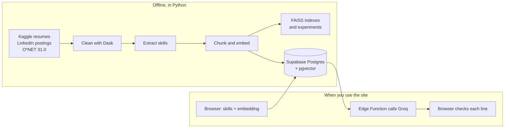

# ScholarStack

Our BDA 696 final project at San Diego State University. You paste a job posting and get back a "reference resume":
an example of what a strong resume for that job looks like, built from real resumes of people who held similar
jobs. Every line cites the resume it came from, so you can check where the advice comes from instead of trusting
a chatbot. If you paste your own resume too, it tells you what's missing.

**Try it:** https://hrushh22.github.io/ScholarStack/

## What happens when you hit Generate

1. We pull the skills out of the posting with a rule-based extractor (1,457 skills, mostly from O*NET).
2. Your browser embeds the job title plus those skills with a small sentence-transformer (all-MiniLM-L6-v2).
3. That vector is used to search 27,207 chunks of 2,480 real resumes in Postgres (pgvector), and to find the closest
   O*NET occupation along with what 106k LinkedIn postings for that occupation ask for.
4. An LLM (gpt-oss-120b on Groq) writes the reference resume using only that evidence, and has to cite the chunk ids
   for every line. Citations to chunks we didn't retrieve get thrown out.
5. Back in the browser, each line is compared with the evidence to flag weak matches.

We compare it against two baselines: plain TF-IDF keyword advice, and the same LLM with no retrieval.

## Results so far

All of this was measured on 240 LinkedIn postings (10 per resume category) that we set aside at the start and never
used for tuning.

| Retrieval setup (top 8 results) | Right category | Shares a hard skill |
|---|---|---|
| MiniLM, section chunks, title + skills as the query (what the site uses) | 61.6% | 60.3% |
| GTE-small, section chunks | 61.8% | 59.2% |
| BGE-small, section chunks | 57.8% | 58.9% |
| MiniLM, fixed 120-word windows | 60.0% | 68.1% |
| TF-IDF | 32.3% | 77.0% |
| MiniLM, but embedding the whole job ad | 56.5% | 47.6% |

A few things we learned:

- Dense retrieval roughly doubles category precision over TF-IDF. TF-IDF looks better on the skill-overlap measure,
  but that measure is basically keyword matching, so it favors TF-IDF by design.
- What you embed mattered more than which model you use. A lot of job ads start with a paragraph about the company,
  and the model only reads the first 256 tokens, so embedding "title + extracted skills" beat embedding the whole ad.
- MiniLM did about as well as GTE-small and is five times faster, which is also why it can run in the browser.
- On all 106,291 posting vectors, exact FAISS search takes 1.96 ms per query. HNSW gets that down to 0.25 ms while
  still finding 99.1% of the same top-10 results.
- The live Postgres search returns the same top 8 as FAISS exact search (we check this every time we load the data).

For generation we used one held-out posting per category (24 total) and had a second model, from a different family
than the writer, check every line against the closest lines from real resumes retrieved for that posting:

| System | Lines backed by real resumes | Posting's skills covered | Occupation's top skills covered |
|---|---|---|---|
| ScholarStack (gpt-oss-120b) | 89.7% | 81.3% | 45.2% |
| Same LLM, no retrieval | 51.8% | 68.2% | 38.7% |
| ScholarStack with the smaller gpt-oss-20b | 81.2% | 61.7% | 43.6% |
| TF-IDF keyword advice | n/a | 30.2% | 9.1% |

- Looking only at the 12 postings where both were checked, 87.7% of ScholarStack's lines were backed by real resumes
  compared with 45.3% for the LLM on its own. The plain LLM writes confident, generic lines that nobody's resume
  actually says.
- 94% of ScholarStack's lines cite at least one excerpt.
- The bigger model covers a lot more of the posting's skills than the 20B one (81% vs 62%).
- The checker ran out of free daily quota halfway, so some outputs aren't checked yet (the Results page lists how many
  were). Re-running `pipeline/10_eval_generation.py` finishes the rest, since every finished call is cached.

Everything is in [`reports/results/`](reports/results) and on the Results page of the site.

## How it's built



The heavy work runs offline. The site itself is just static files on GitHub Pages. The LLM is called from a
Supabase Edge Function so the API key never ends up in the browser. The Python evaluation and the live site use the
exact same prompt file (`supabase/functions/_shared/prompts.json`), so what we evaluated is what's running.

We also checked that the JavaScript versions of skill extraction, query building and the TF-IDF baseline give the
same results as the Python versions on 100 held-out postings, and that the browser embeddings match Python's.

## What's in the repo

```
config/            settings (models, paths, seeds), our skill list, the fake sample resumes
src/scholarstack/  the Python package: cleaning, skills, chunking, embeddings, FAISS, O*NET linking,
                   TF-IDF baseline, generation (LangChain), metrics
pipeline/          numbered scripts 01 to 14, run them in order
supabase/          database schema and the Edge Function
web/               the website (plain JavaScript, no build step)
reports/           figures and result tables
docs/              notes for writing the final paper
data/              created by the pipeline, not committed (see data/README.md)
```

## Running it yourself

You need Python 3.12 and about 2 GB of disk. The whole pipeline takes around 20 minutes on a laptop.

```bash
python3.12 -m venv .venv && source .venv/bin/activate
pip install -r requirements.txt && pip install -e .
cp .env.example .env              # only needed for steps 10 to 12

./run_pipeline.sh                 # steps 01-09, 13 and 14, no API keys needed
./run_pipeline.sh --with-llm      # also step 10, which needs a Groq key
```

| Step | What it does |
|---|---|
| `01_acquire.py` | Downloads both Kaggle datasets and O*NET 31.0 and records SHA-256 hashes. `--upload` copies the raw files to S3-compatible storage through fsspec |
| `02_profile.py` | Converts the 517 MB postings CSV to Parquet and profiles every source (columns, nulls, duplicates, outliers) |
| `03_clean.py` | Splits resume HTML into sections, cleans and de-duplicates the postings on a Dask cluster (123,849 down to 106,291), builds O*NET occupation profiles |
| `04_skills.py` | Builds the skill dictionary and extracts skills from every resume and posting |
| `05_chunk_embed.py` | Section chunks vs fixed windows, embedded with MiniLM, BGE-small and GTE-small |
| `06_index.py` | FAISS indexes over the resume chunks and all postings, plus the Flat/HNSW/IVF benchmark |
| `07_onet_link.py` | Matches posting titles to O*NET's 54k job titles, summarizes demand per occupation, builds the test set |
| `08_eval_retrieval.py` | The retrieval experiments above |
| `09_eda.py` | EDA figures |
| `10_eval_generation.py` | Generation experiments: ScholarStack vs LLM-only vs TF-IDF, model size, O*NET on/off, number of excerpts |
| `11_load_database.py` | Creates the tables and loads the chunks and O*NET data into Supabase |
| `12_deploy_supabase.py` | Sets the Edge Function secrets, deploys it, writes the browser config |
| `13_export_web.py` | Exports the skill list, TF-IDF model, samples, results and figures for the site |
| `14_report_figures.py` | Result figures for the paper and slides |

To look at the site locally: `cd web && python -m http.server 8000`, then open http://localhost:8000.

## Deploying (all free)

1. Make a Groq API key at https://console.groq.com and put it in `.env` as `GROQ_API_KEY`.
2. Make a Supabase project. Put the project URL, the session pooler connection string (with your database password)
   and a personal access token in `.env`.
3. Run `python pipeline/11_load_database.py`, then `python pipeline/12_deploy_supabase.py`, then commit
   `web/js/config.js` and push.
4. In the repo settings, set Pages > Source to "GitHub Actions". The workflow in `.github/workflows/pages.yml`
   publishes `web/` on every push.

## How we evaluated it

| What | How |
|---|---|
| Retrieval precision@k | There are no hand-labeled relevance judgments, so we used two stand-ins: the excerpt comes from a resume in the posting's category, or it shares at least one hard skill with the posting |
| Grounding | A second model from a different family checks every generated line against the closest lines from real resumes retrieved for that posting. Every system is checked against the same evidence. We also check the same lines against an unrelated posting's resumes to get a chance level |
| Citations | How many lines cite something, and whether the cited chunks were actually retrieved |
| Skill coverage | How many of the posting's hard skills, and of the occupation's 10 most requested skills, show up in the output |
| Quality | A judge model plays career advisor and picks the better of two outputs (order shuffled). The site also collects 1 to 5 star ratings from real users |
| Speed | Embedding throughput, FAISS build and query time, end-to-end latency |

## Data

| Dataset | Where it's from | What we use it for |
|---|---|---|
| Resume Dataset (2,484 LiveCareer resumes, 24 categories) | [Kaggle](https://www.kaggle.com/datasets/snehaanbhawal/resume-dataset) | The resumes we cite |
| LinkedIn Job Postings 2023-24 (123,849 postings) | [Kaggle](https://www.kaggle.com/datasets/arshkon/linkedin-job-postings) | Job ads, skill demand, the test set |
| O*NET 31.0 | [National Center for O*NET Development](https://www.onetcenter.org/database.html) | Standard skills, knowledge, tasks and tools per occupation |

O*NET is a trademark of the U.S. Department of Labor, Employment and Training Administration, and the data is used
under CC BY 4.0. We don't put raw resume text in this repo.

## Limitations

- The resumes are examples from one website, not verified employees, and some categories (BPO, Automobile) are broad
  keyword buckets.
- Our relevance labels are stand-ins, and the grounding checker is itself an LLM.
- The postings are a 2023-24 snapshot, and O*NET describes occupations, not specific jobs.
- A reference resume is for learning. Only put experience on your resume that you actually have.

## Team

Hrushik Mehta · Dhrumil Panchal · Sonika Srinivas · Parjanya Hebbale Krishna

## References

- Lewis et al. (2020). Retrieval-augmented generation for knowledge-intensive NLP tasks. NeurIPS.
- Reimers and Gurevych (2019). Sentence-BERT. EMNLP.
- Johnson, Douze and Jégou (2021). Billion-scale similarity search with GPUs. IEEE Transactions on Big Data.
- Es et al. (2024). RAGAS: Automated evaluation of retrieval augmented generation. EACL demos.
- Spärck Jones (1972). A statistical interpretation of term specificity. Journal of Documentation.
- Dask Development Team (2016). Dask: Library for dynamic task scheduling.
- National Center for O*NET Development. O*NET 31.0 Database.
